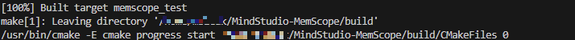
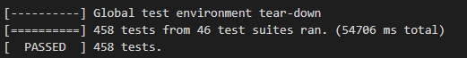
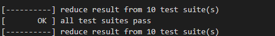

# msMemScope Development Guide

## 1. Development Environment Settings

Complete the compilation and test environment setup by referring to the [msMemScope Installation Guide — Installation from Source](../install_guide/install_guide.md#231-environment-preparation) section.

> **Note:** For the method for building the environment image and the accompanying software versions, see the unified MindStudio image building guide, which is not redefined in this repository.

### 1.1 Containerized Development Environment

msMemScope provides a consistent containerized development environment based on [devcontainer](https://containers.dev/). Opening the repository in VS Code lets you enter the container, build, and start graphical debugging with one click, with code navigation working out of the box.

**Prerequisites**: Install VS Code on your PC and install the Dev Containers and Remote-SSH extensions for VS Code. The Linux server must provide Docker services (including the Ascend environment).

**Entering the container**: Open the repository in VS Code → click "Reopen in Container" in the lower-right corner → wait for `post-create.sh` to complete initialization automatically (Git identity synchronization, Python 3.11, pre-commit hook installation, clangd, and so on; idempotent and failure non-blocking).

**One-click build** (task panel `Terminal → Run Task`):

| Task | Function |
| --- | --- |
| `Build: Release Mode` | Full Release build (equivalent to the command `python3 build.py`) |
| `Build: Debug Mode` | Debug compilation after third-party dependencies are downloaded (with `-g -O0` debug symbols and without stripping) |
| `Test: Build Unit Tests` | Compiles unit tests only (for debugging) |
| `Test: Run Unit Tests` | Builds and runs unit tests (equivalent to the command `python3 build.py test`) |
| `Clean: All Workspace` | Cleans build artifacts |

**One-click debugging** (press `F5` and select a configuration): `GDB: Launch Main Program` debugs `output/bin/msmemscope.bin`; `GDB: Debug Unit Test (UT)` debugs `build/test/memscope_test`. A Debug build is performed automatically before debugging.

**Code navigation**: for C++, clangd reads `build/compile_commands.json` (generated after the first build); for Python, Pylance provides semantic navigation.

**Precautions**:

- Compilation must be performed inside the container. The command-line entry point (`python3 build.py`) outside the container remains available.
- Debug and Release artifacts overwrite each other at the same paths. When switching between the two modes, rebuild the target mode.
- Local personal modifications to `.vscode/settings.json` do not appear in `git status` (managed with skip-worktree).

## 2. Procedure

### 2.1 Downloading Code

Fork the repository to your private repository and clone the project in the private repository into the compilation container.

Note: If you use HTTPS to clone the repository, set a token as the password as required by GitCode.

### 2.2 Downloading Third-Party Dependencies and Compiling Projects

Before the first compilation and building, you need to download some dependencies of the repository. The repository provides scripts to assist in dependency download, compilation, and building.

Before running the following commands, ensure that your terminal has accessed the code repository directory inside the container and the network is normal.

```shell
cd <path>/memscope   # Go to the memscope code repository directory; path is the path where the code repository project resides.
python3 build.py local test
```

Parameters:

- `local`: local building. If this parameter is added, dependencies such as gtest, json, and secure are downloaded for local building. Generally, these dependencies are downloaded only for the first building unless they are updated.
- `test`: test cases.

After the dependencies are successfully downloaded, the following information is displayed.

```shell
============ download third-party done ============
```

After the compilation is successful, the following information is displayed.



#### 2.2.1 Debug Build and UT Debugging

The default build is Release (`-O2` + strip). To use GDB breakpoint debugging, perform a Debug build (`-g -O0`, without strip):

```shell
cd <path>/memscope   # Go to the memscope code repository directory; path is the path where the code repository project resides.
python3 build.py -e only_down_deps=true   # Download third-party dependencies only and then exit.
cd build
cmake .. -DCMAKE_BUILD_TYPE=Debug
make -j$(nproc)
```

Debug artifacts overwrite Release artifacts at the same paths (`output/bin` and `output/lib64`). When switching the build mode, rebuild the target mode.

For unit test debugging, perform a Debug build first (`-DBUILD_TESTS=ON`), and then set breakpoints on `build/test/memscope_test` to debug:

```shell
cd build
cmake .. -DBUILD_TESTS=ON -DCMAKE_BUILD_TYPE=Debug
make -j8
```

> When developing with devcontainer, you do not need to run the preceding commands manually. The VS Code task panel provides one-click entries such as `Build: Debug Mode` and `Test: Build Unit Tests`, and `F5` starts GDB debugging directly.

### 2.3 Developing Functions

The implementation code of msMemScope is divided into three main modules: csrc, python, and test. The directory structure is as follows:

```shell
|-- csrc                 # C++ source code
   |-- framework         # Command line parsing, interacting with event_trace to obtain memory events and send the events to analysis for processing.
   |-- event_trace      # Records memory events and submits them to framework.
   |-- analysis         # Analyzes and processes memory events.
   |-- utility          # General non-service functions
   |-- python_itf        # Provides the Python-bound interface layer binding for C++.
   |-- main.cpp
|-- python              # Python source code
   |-- msmemscope
|-- test                # UT and ST
```

When modifying, adding, or deleting service code, modify the corresponding test code.

### 2.4 Verifying Functions

After a function is developed, you need to debug and verify the function locally. Run the following commands to complete function building and deployment.

```shell
cd build
cmake ..
make
```

You can specify the `-j` parameter during compilation to enable parallel compilation. For example, to enable eight threads for parallel compilation, run the following command:

```shell
make -j8
```

The compilation output is deployed in the `output` directory. The directory structure is as follows:

```shell
output
├── bin
│   ├── msmemscope
│   └── msmemscope.bin
├── lib64
│   ├── _msmemscope.so
│   ├── libascend_kernel_hook.so
│   ├── libascend_leaks.so
│   ├── libascend_mstx_hook.so
│   ├── libatb_abi_0_hook.so
│   ├── libatb_abi_1_hook.so
│   └── libleaks_ascend_hal_hook.so
```

#### 2.4.1 Performing UT

The UT cases are stored in the `./test` directory. The gtest framework is used to perform UT. The rules for adding UT cases are as follows:

1. The case directory structure must be the same as the code directory structure. The naming format is `test_functional module`.
2. To facilitate fault locating, the case name format is `Functional module_Function to be tested_Expected result`.
3. If you add a directory and source code to `./csrc`, add a directory with the same name to `./test` and add test cases when compiling UT cases. In addition, add the source code directory to `./test/CMakeLists.txt`.

After a test case is developed, run the following commands to automatically build and run the test case. Ensure that all test cases pass.

```shell
cd ..
bash ./build/run_test_case.sh
```

If all UT cases pass, the following information is displayed.



Note: UT cases must meet the following coverage requirements.

| Category| Coverage|
| --- | --- |
| Line coverage rate| 80.0% |
| Branch coverage rate| 60.0% |

Typically, when code is committed, the gated check-in automatically runs and generates a coverage report. (You are advised to view the coverage report in the gated check-in. The local coverage report may be different from that in the gated check-in.) To generate a report locally, run the following commands:

```shell
# Ensure that the test cases have been run before the report is generated.
bash ./build/run_test_case.sh
bash ./build/generate_coverage.sh
```

The report is generated in the `./coverage/report.tar.gz` directory. You can download the report and open the **index.html** file using a browser.

#### 2.4.2 Performing ST

After an ST case is developed, run the following commands to automatically build and run it. Ensure that all ST cases pass.

```shell
cd ./test/smoke
bash run_st.sh
```

> [!NOTE]
>
> When developing with devcontainer, the container environment does not automatically mount NPU devices, so ST cannot be executed. In this case, you need to set up a runnable environment yourself.

If all ST cases pass, the following information is displayed.



### 2.5 Adding an Example

If you have developed a new function and need to add an example to show the function, perform the following steps:

1. Add the function directory based on the format in the `./example` directory.
2. Add the README file of your function to describe the features, preparations, execution examples, and results.
3. Add sample execution code in API mode. Both Python and bash scripts are required.
4. Add the following environment variable settings of API mode to the bash script:

```shell
#!/bin/bash

TOOL_PATH='msmemscope_path'
export LD_PRELOAD=${TOOL_PATH}/lib64/libleaks_ascend_hal_hook.so:${TOOL_PATH}/lib64/libascend_mstx_hook.so:${TOOL_PATH}/lib64/libascend_kernel_hook.so
export LD_LIBRARY_PATH=${TOOL_PATH}/lib64/:${LD_LIBRARY_PATH}
```
