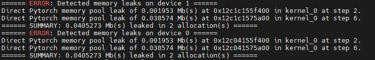
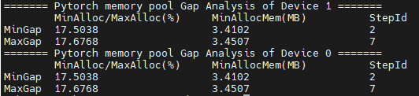
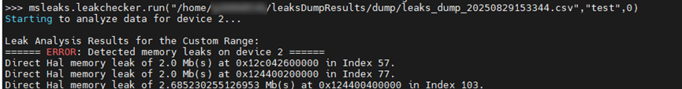

# **Memory Analysis**

## Overview

msMemScope provides analysis capabilities such as leak detection, comparison, monitoring, decomposition, identification of inefficient memory, and OOM analysis based on the collected memory data, helping you quickly diagnose and optimize memory problems.

|Analysis Capability|Description|
|--|--|
|Memory leak|If memory is not released for a long time or memory leaks occur, msMemScope provides memory leak analysis and kernel-launch-based memory change analysis to locate and analyze problems.|
|Memory comparison|If the memory usage differs between two steps, it may lead to excessive memory usage or even Out of Memory (OOM) errors. In this case, use the memory comparison analysis function of msMemScope to locate and analyze the problem.|
|Memory block monitoring|In foundation model scenarios, if it is difficult to locate memory corruption, msMemScope can monitor the specified memory blocks before and after operator execution through Python APIs and CLIs. Based on changes in the memory block data, it can quickly determine the scope or exact location of memory corruption between operators.|
|Memory decomposition|msMemScope supports memory decomposition to analyze the memory usage of the CANN layer and Ascend for PyTorch framework and outputs model weights, activations, gradients, and optimizer and other component memory usage.|
|Identification of inefficient memory|During model training and inference, some memory blocks may not be used immediately after being allocated or may not be deallocated in a timely manner after being used. msMemScope identifies the inefficient memory usage to optimize model training and inference.|
|OOM analysis|When OOM occurs during NPU training or inference, msMemScope automatically collects the operation information that triggered the OOM, the most recently unreleased memory allocation records, and the memory allocation records with the largest usage, helping you quickly locate the root cause of the OOM.|
|One-click analysis|msMemScope supports one-click memory decomposition and memory snapshot to improve memory analysis usability, allowing core functions of vLLM, FSDP, and verl to be automatically hooked for quick analysis.|
|NPU Sanitizer|For custom operators, msMemScope, in coordination with NPU Sanitizer, provides the custom operator instrumentation feature, allowing developers to feed memory read-write information into the Sanitizer analysis pipeline via a reported formatted message string for detecting multi-stream synchronization errors.|
|Host heap memory leak detection|To address the memory growth caused by host-side process heap memory that is not released for a long time during training and inference, msMemScope aggregates and analyzes the host heap memory blocks that are allocated and not released within the detection range by call stack, and outputs a leak overview report and per-block details, enabling the location and analysis of host heap memory leaks.|

## Preparations

For details about how to install msMemScope, see the [msMemScope Installation Guide](../install_guide/install_guide.md).

## Memory Leak Analysis

### Function Description

Memory issues include memory leak, corruption, and fragmentation, which may cause excessive memory usage. msMemScope can locate memory leak issues.

### Precautions

- If the **--events** parameter needs to be set when the memory analysis function is used, ensure that the **--events** parameter contains **alloc** and **free**.
- Do not set the **--steps** parameter when using the memory analysis function.
- Currently, offline analysis mode supports only HAL memory leak analysis.
- Currently, memory leak analysis does not apply to vLLM-Ascend.

### Usage Example

Memory leak analysis supports both online and offline modes.

**Online Mode**

During memory analysis, use the mstx instrumentation function to locate issues. For details about mstx instrumentation, see [MindStudio Tools Extension Library Interfaces](https://gitcode.com/Ascend/mstx/blob/master/docs/en/api_reference/README.md).

1. Use msMemScope to start the user program (represented by **Application**).

    ```shell
    msmemscope ${Application}
    ```

2. Check the command output after the command is executed.
    - If the information shown in [Figure 1 Memory leak](#leak) is displayed, a memory leak occurs. The command output displays the summary information about memory leaks of each device, including the number of steps where memory leak occurs, associated kernel, address, and leak size.

        Figure 1 Memory leak<a id="leak"></a>

        

    - If the information shown in [Figure 2 Memory fluctuation](#fluctuation) is displayed, the memory fluctuates. The command output displays the memory fluctuation in a single step (defined by the ratio of the minimum memory pool allocation to the maximum memory pool allocation) and the minimum memory pool allocation. The minimum ratio and maximum ratio are provided as references. Users can determine whether there is a memory leak risk based on the ratio.

        > [!NOTE]
        >
        > The memory is not stable in the first step. Therefore, only the memory fluctuation from the second step can be analyzed. The memory fluctuation in the first step can be ignored.

        Figure 2 Memory fluctuation <a id="fluctuation"></a>

        

**Offline Mode**

msMemScope supports offline leak analysis of memory events in a specified range. After using mstx to mark the memory leak analysis range, you can use this function to analyze the dumped files.

1. Apply the mstx mark function to the range where leak detection is required. For details about mstx instrumentation, see [MindStudio Tools Extension Library Interfaces](https://gitcode.com/Ascend/mstx/blob/master/docs/en/api_reference/README.md).

    > [!NOTE]
    >
    > - The mark information is used as the input of the offline analysis interfaces.
    > - Use the mark function to mark three points, which are referred to as A, B, and C. The memory allocated within the range from A to B must be deallocated before point C. Otherwise, the memory is considered as a memory leak.

2. Use the msMemScope to start the user program (represented by **Application**) and obtain the dumped .csv file.

    ```shell
    msmemscope ${Application}
    ```

3. Call the Python interface to perform offline leak analysis on the .csv file.

    ```python
    import msmemscope
    msmemscope.check_leaks(input_path="user/memscope.csv",mstx_info="test",start_index=0)
    ```

    The parameters are as follows:

    - **input_path**: path of the .csv file. An absolute path is required.
    - **mstx_info**: mstx text information used for mark instrumentation, which is used to mark the range of leak analysis.
    - **start_index**: ID of the instrumentation location where the memory leak analysis starts, that is, the sequence number of the mstx instrumentation location that meets the analysis conditions.

    If the information shown in [Figure 3 Offline leakage analysis](#analysis) is displayed, a memory leak occurs.

    Figure 3 Offline leakage analysis <a id="analysis"></a>

    

## Host Heap Memory Leak Detection

### Function Description

Host heap memory leak detection addresses the memory growth caused by host-side process (CPU-side) heap memory that is not released for a long time during training and inference. It aggregates the host heap memory blocks that are allocated and not released within the detection range (window) by call stack, and outputs a leak overview report and per-block details, helping you locate the leaking call stacks and the leak scale.

- **Single ledger + closed-window snapshot**: The block table on the hook side is the only ledger, and no data is transferred across layers during a window. Aggregation is performed once when the window ends, keeping hot-path overhead low (full tracking by default, with no reliance on sampling).
- **Leak location and assessment**: Outputs the call stacks of the TOP N leak sites (10 by default), the unfreed block size distribution, and per-block details (optional). Combined with the tick time series (1 second per tick), the sites are sorted by the Leak Suspicion Index (LSI) and classified into suspected leaks, growth watch, and resident baselines.
- **Honest labeling**: Tracking decisions such as block threshold filtering, sampling, table-full degradation, and truncation are truthfully labeled in the "Data Health Analysis" chapter of the report, with no implicit record dropping at runtime.
- **In-window inspection**: Supports querying an interim leak overview while the window is open through the out-of-process control channel (`msmemscope --pid <PID>`), without closing the window or affecting accounting.
- **Three usage modes**: CLI mode, Python API mode, and out-of-process control channel mode.

Host heap memory leak detection is independent of device-side memory leak analysis, and the two can be used separately. It is mutually exclusive with the `leaks`, `decompose`, `inefficient`, and `oom` analysis items and cannot be enabled together with them in the same configuration.

### Usage Example

The semantics of the detection range (window) are as follows:

- **CLI mode**: The window opens as soon as the target process starts, and closes automatically when the process exits, at which point the report is output.
- **Python API mode**: `msmemscope.start()` opens the window and `msmemscope.stop()` closes it. Each `start`/`stop` pair corresponds to one detection window and outputs one report. Including `host-leaks` in `analysis` is a prerequisite for opening the window (enabling configuration). When collection stops, the window closes automatically and the report is output.
- **Out-of-process control channel mode**: For a running process that has loaded `libascend_leaks.so`, after attaching with `msmemscope --pid <PID>`, you can open and close the window with `start`/`stop` and query the interim overview of the window with `display host_leak summary`. For details, see [Out-of-Process Control Channel (Dynamic Attach)](./memory_profile.md#out-of-process-control-channel-dynamic-attach).

**CLI mode**

1. Use msMemScope to start the user program, where `Application` is the user program and its parameters.

    ```shell
    msmemscope --analysis=host-leaks [--host-leak-mode=MODE] [--block-size-threshold=N] [--sample-rate=N] ${Application}
    ```

    Example:

    ```shell
    msmemscope --analysis=host-leaks --block-size-threshold=1024 --sample-rate=1 --output-path=./output python ./train.py
    ```

    > [!NOTE]
    >
    > - In CLI mode, when `--analysis` contains `host-leaks`, the msMemScope launcher automatically sets up the hooks in host mode (`LD_PRELOAD` loads only `libmsmemscope_host_mem_hook.so`), with no need to set environment variables manually.
    > - You can also set up the host hook environment manually with `source msmemscope --load-api-env=host` (required for the Python API mode), and clear it with `source msmemscope --unload-api-env` when you are done.

2. After the target process exits, a leak overview report is generated in the `output` directory. For details, see [Output Description](#host-heap-memory-leak-detection-output-description).

**Python API mode**

1. Set environment variables to set up the host hooks.

    ```shell
    source msmemscope --load-api-env=host
    ```

2. Configure the enabling settings and start and stop the detection in the user script.

    ```python
    import msmemscope
    # Configuration enabling: including host-leaks in analysis is a prerequisite for opening the window (parameters such as host_leak_mode must be adjusted after the window is closed)
    msmemscope.config(analysis=["host-leaks"], host_leak_mode="summary", block_size_threshold="1024")
    msmemscope.start()          # Open the window: start the detection range
    # ... train for several steps ...
    msmemscope.stop()           # Close the window: stop the detection range, aggregate and output the report
    ```

    Each `start()`/`stop()` pair corresponds to one detection window and outputs one overview report (the window index increases). While the detection window is open (after `start()` and before `stop()`), calls to `config()` do not take effect and a warning is printed. To adjust the detection parameters, call `stop()` to close the window first, adjust the parameters, and then call `start()` to open a new window.

    > [!NOTE]
    >
    > - When `analysis` contains `host-leaks` but the host hooks are not set up in the current process (`source msmemscope --load-api-env=host` has not been executed), the API throws a `ValueError` prompting you to set up the environment first.
    > - The report is output immediately after the window is closed. If a window is still open when the process exits, it is closed automatically.

**Out-of-process control channel mode**

1. The target process must have loaded `libascend_leaks.so` (a process started through msMemScope, or one that has executed `source msmemscope --load-api-env[=npu|host]`).

2. Run the following command to attach to the target process, where `PID` is the process ID, and enter the interactive control session.

    ```shell
    msmemscope --pid <PID>
    ```

3. In the session, run `display host_leak summary` to query the interim leak overview of the current detection window (valid while the window is open; `no active window` is returned when the window is closed).

    ```text
    msmemscope> display host_leak summary
    ```

    The chapter structure of the interim overview is the same as that of the closed-window report. For the differences and labels, see [Interim Overview Within the Window (Inspection)](#interim-overview-within-the-window-inspection).

4. For scripted inspection, use the `--command` parameter to send a single control word, after which the tool exits automatically.

    ```shell
    msmemscope --pid <PID> --command "display host_leak summary"
    ```

### Parameter Description

The host heap memory leak detection parameters are listed in [**Table 1** Host heap memory leak detection CLI parameters](#host-heap-memory-leak-detection-cli-parameters).

**Table 1** Host heap memory leak detection CLI parameters<a id="host-heap-memory-leak-detection-cli-parameters"></a>

|Parameter|Default value|Description|
|--|--|--|
|`--analysis=host-leaks`|— (the default analysis item is `leaks`)|Enables host heap memory leak detection. Mutually exclusive with `leaks`, `decompose`, `inefficient`, and `oom`, and cannot be enabled together with them in the same configuration.|
|`--host-leak-mode <MODE>`|`summary`|Reporting mode: `summary` outputs only the overview report aggregated by call stack; `event` outputs the per-block detail CSV in addition to the overview report.|
|`--block-size-threshold <N>`|`0`|Block size threshold (bytes): only allocations with a size greater than or equal to N are recorded. The default value 0 indicates full tracking. When it is explicitly set to a value greater than 0, allocations smaller than the threshold do not enter the ledger, and their count and total size are labeled in the "Data Health Analysis" chapter of the report.|
|`--sample-rate <N>`|`1`|Inverse sampling rate: 1 indicates no sampling; N greater than 1 indicates that only about 1/N of the allocations are recorded. A value other than 1 is rounded up to a power of 2 (for example, 3 → 4), and a value greater than 2^30 is truncated to 2^30. The report labels the sampled view. Use this only in scenarios with an extreme allocation rate.|

The threshold and the sampling rate take effect as a snapshot when the window is opened. Changes made while the window is open do not take effect (they do not affect the current window but take effect from the next window).

In the Python API mode, the same configuration is delivered through `msmemscope.config(**kwargs)`. The corresponding keys are listed in [**Table 2** Host heap memory leak detection Python config keys](#host-heap-memory-leak-detection-python-config-keys), and their values must be strings.

**Table 2** Host heap memory leak detection Python config keys<a id="host-heap-memory-leak-detection-python-config-keys"></a>

|Config Key|Default value|Description|
|--|--|--|
|`analysis=["host-leaks"]` (or `analysis="host-leaks"`)|—|Enables host heap memory leak detection (a prerequisite for opening the window). The mutual exclusion check is the same as that of the CLI. The actual opening and closing of the window is controlled by `start()`/`stop()`.|
|`host_leak_mode`|`"summary"`|Reporting mode, corresponding to `--host-leak-mode`.|
|`block_size_threshold`|`"0"`|Block size threshold, corresponding to `--block-size-threshold`.|
|`sample_rate`|`"1"`|Inverse sampling rate, corresponding to `--sample-rate`.|

### Output Description<a id="host-heap-memory-leak-detection-output-description"></a>

The output files of host heap memory leak detection are saved in the `{output}/msmemscope_{*PID*}_{_timestamp_}_ascend/host_leak/` directory (`{output}` is the output directory specified by `--output-path`, which defaults to `./memscopeDumpResults`), as listed in [**Table 3** Host heap memory leak detection output files](#host-heap-memory-leak-detection-output-files).

**Table 3** Host heap memory leak detection output files<a id="host-heap-memory-leak-detection-output-files"></a>

|Output file|Condition|Content|
|--|--|--|
|`leak_overview_{*stage*}.txt`|Output by default; generated in both summary and event modes|Leak overview report: data health analysis, total unfreed, unfreed block size distribution, pre-window free size distribution, and TOP N leak sites with call stacks. `{stage}` is the window index.|
|`block_detail_{*stage*}.csv`|Generated only when `--host-leak-mode=event` and unfreed blocks exist in the window|Per-block leak details: `addr,size,alloc_ts,Call Stack(C),Call Stack(Python)`, sorted in descending order of block size, with call stack text inlined (RFC 4180 quoted fields).|

The two files correspond one-to-one to the stage index. For details about the fields and format, see [Output File Specifications](./output_file_spec.md).

### Report Interpretation<a id="host-heap-memory-leak-detection-report-interpretation"></a>

The leak overview report (`leak_overview_{*stage*}.txt`) contains the following chapters:

|Chapter|Description|
|--|--|
|Data Health Analysis|Truthfully labels the tracking decisions of this window: detection window start and stop times, reporting mode, total allocation/deallocation counts, number of unique call stacks (key depth: K=20; a class is the attribution semantics for allocations whose first K frames are identical), number of unattributed blocks (migrated to the unknown bucket when the stack table is exceeded), dead stack eviction statistics, truncation labels (bit0 = full block table, migrated to the overflow channel; bit1 = full stack table full, new stacks migrated to the unknown bucket when dead stack reclamation has nothing to supply; bit2 = full overflow ledger, accounting stopped), overflow channel statistics, pre-window free statistics, sampling rate (sampled views are labeled when the value is not 1), block threshold and untracked statistics, and symbolization coverage. When the window data is incomplete, it is clearly labeled as "not usable as a leak conclusion".|
|Total Unfreed|Total number of blocks and bytes allocated and not released in this window (including surviving blocks in the unknown bucket and the overflow channel), an exact value obtained by traversing the ledger when the window is closed.|
|Unfreed Block Size Distribution|Number of blocks, bytes, and proportion of unfreed blocks bucketed by size (7 buckets by default: 0–256 B, 256 B–1 KB, 1 KB–4 KB, 4 KB–32 KB, 32 KB–256 KB, 256 KB–1 MB, and above 1 MB).|
|Pre-Window Free Size Distribution|Memory allocated before the window opened and deallocated during the window, bucketed by size (a separate channel that does not participate in leak determination and is provided for cache aging scenario analysis).|
|TOP N Leak Sites|List of leak sites sorted in descending order of the LSI (0–100, where a higher value indicates a higher probability of a real leak) (N=10 by default, up to 1024). Each row contains: status classification (`suspected_leak` = suspected leak, `growth_watch` = growth watch, with `/turnover` appended when the turnover ratio criterion is met but the tail still grows), the LSI value, five assessment factors (Growth/Release/Lifetime/Pattern/Scale), unfreed/allocated/deallocated statistics, the sequence growth slope (B/tick) and tick count, and the complete symbolized stack text. The first row of the chapter outputs the tick series metadata (top-k=256, max-stacks=1024, tick count, and window duration). Rows for unattributed blocks are unknown bucket rows, and a missing stack text is labeled as `(unresolved stack <stack id>)`. When the sequence data is unavailable, the corresponding Growth/Pattern factor displays `-` and the reason for degradation (no_series/series_evicted/insufficient_series/no_warmup_thread) is labeled.|
|Resident Baselines|List of resident stacks with a considerable unfreed amount in the window, sorted in descending order of the unfreed amount and without occupying TOP N slots. The criterion source of each row is labeled `resident/early` (G≈0 and allocated early) or `resident/turnover` (low unfreed/allocated ratio and no growth at the tail). Closed-window reports are not truncated, while the interim overview is truncated to no more than TOP N rows. When the pre-window free size exceeds half of the total allocations within the window, the report additionally outputs a cache turnover NOTE.|

### Interim Overview Within the Window (Inspection)<a id="interim-overview-within-the-window-inspection"></a>

While the detection window is open, you can query the interim overview of the window with the `display host_leak summary` command of the out-of-process control channel. The interim overview is generated by the hook by taking a one-time snapshot of the ledger and aggregating it without closing the window, clearing data, or affecting accounting. Its chapter structure is the same as that of the closed-window report (Data Health Analysis/Total Unfreed/Unfreed Block Size Distribution/Pre-Window Free Size Distribution/TOP N Leak Sites/Resident Baselines). The differences and labels are as follows:

|Difference|Description|
|--|--|
|Report header line and Window line|The header line is labeled `(interim snapshot)` (for example, `====== Host Leak Overview (interim snapshot): stage=1, pid=1234 ======`), and the Window line is labeled `(interim snapshot, window open)`. The window duration is from the time the window was opened to the time of the snapshot.|
|Snapshot freeze|Allocations that arrive while the snapshot is being aggregated are counted in the statistics only and do not enter the block table of this snapshot. The overview truthfully labels their count and bytes (output only when there are allocations during the freeze period).|
|Snapshot degraded|Labeled when some shard locks fail to be acquired while reading this snapshot: block table reads return prefix data, stack table reads make attribution incomplete, and series/pre-window free reads are partially missing. This affects only this snapshot, and the window continues normal accounting.|
|Resident baselines|Truncated to no more than TOP N rows (closed-window reports are not truncated).|
|Per-block details|The interim overview does not generate the `block_detail` CSV.|

When the command is executed after the window is closed (or before it is opened), `no active window` is returned.

### Precautions

- The runtime environment must be a Linux OS (x86_64 or aarch64).
- Host heap memory leak detection is independent of device-side memory leak analysis. It is mutually exclusive with the `leaks`, `decompose`, `inefficient`, and `oom` analysis items and cannot be enabled together with them in the same configuration.
- This function covers only standard heap allocation APIs (`malloc`/`calloc`/`realloc`/`posix_memalign`/`aligned_alloc`/`memalign`/`valloc`/`pvalloc`). Non-heap allocations such as `mmap` are not accounted for.
- Memory that was already allocated before the window opened does not enter the ledger. Pre-window memory released during the window is counted in the separate "pre-window free" channel and is not included in the total allocation/deallocation counts or in leak determination.
- When `--block-size-threshold` or `--sample-rate` is set, the unfreed amount in the report is a view under the corresponding tracking decisions and is truthfully labeled; it does not represent the full result.
- The `block_detail_{*stage*}.csv` per-block details cover only the block table scope. Blocks in the overflow channel (migrated there when the block table is full) have no stack attribution and do not appear in the details, but they are already counted in the total unfreed amount and the size distribution. The difference between the total unfreed amount in the overview and the sum of the details is the number of overflow channel blocks.
- Child processes created by fork are not covered by detection (the hooks are automatically disabled in child processes). In distributed training scenarios, each process opens its own window and generates its own report.
- Snapshots and statistics within a detection window are pulled at once when the window is closed. If the statistics are unavailable due to an extremely early exit, the report labels them as `Snapshot: unavailable` instead of outputting speculative data.
- If a window is not closed when the process exits, msMemScope closes it automatically and outputs the report (the closing aggregation waits for up to 120s).
- LSI assessment depends on tick series data (1 second per tick, top-k=256 per tick, and a maximum of 1024 series stacks). When the series is missing, its slots are evicted, or it is too short, or there is no warmup thread in the entire window, the Growth/Pattern factor of the corresponding leak site displays `-`, the entry is labeled `degraded`, and the reason for degradation (no_series/series_evicted/insufficient_series/no_warmup_thread) is given, with the LSI treated as neutral.
- Allocations that arrive during the snapshot freeze period of the `display host_leak summary` interim overview are counted in the statistics but do not enter the snapshot block table. The overview truthfully labels this, and the window continues normal accounting unaffected.
- When `msmemscope --pid` is used for attached inspection, the target process must have loaded `libascend_leaks.so` (a process started through msMemScope or one that has executed `source msmemscope --load-api-env[=npu|host]`). The attach mode is mutually exclusive with `--compare` and the direct startup command. For details, see [Out-of-Process Control Channel (Dynamic Attach)](./memory_profile.md#out-of-process-control-channel-dynamic-attach).

### Restrictions

- This function targets the detection of host heap memory that is not released within a range, and the report conclusions apply to the detection window only. They cannot be directly extrapolated to leaks of the process as a whole.
- In scenarios with an extremely high allocation frequency (millions per second) and an extremely large number of long-lived blocks, once the block table capacity (20 million entries by default) is reached, allocations are migrated to the overflow channel (with no stack attribution). When the overflow ledger is also full, accounting stops, and the window data is the complete prefix before the truncation point; the report clearly states that it cannot be used as a leak conclusion. In such scenarios, explicitly set the block size threshold or the sampling rate.
- When the stack table capacity (400 thousand entries by default) is reached, dead stacks (call stacks all of whose blocks have been released) are reclaimed to free up slots, and their historical counts are folded into the unknown bucket row. When the table is fully live, new call stacks are placed in the unknown bucket. Attribution granularity degrades but accounting continues, and the report truthfully labels this.
- The key depth `K` is 20 frames by default: allocations whose first 20 call stack frames are identical are grouped into the same "class". `K` can be found in the report labels. The actual key depth depends on the runtime library, and the class semantics of `K`-frame consistency may differ between library versions.

## Memory Comparison

### Function Description

If the training and inference parameters are the same but the CANN version does not match the version of Ascend for PyTorch or MindSpore, memory usage of two different steps of training and inference jobs may be different, causing excessive memory usage or even OOM. msMemScope then can be used to compare memory to effectively locate memory issues.

### Precautions

Before using this function, collect data of two different steps.

### Usage Example

1. Disable the optimization of the **task_queue** operator dispatch queue.

    ```shell
    export TASK_QUEUE_ENABLE=0
    ```

2. Add the mstx instrumentation code to the training/inference code. For details, see [Memory Leak Analysis](#memory-leak-analysis).
3. Use msMemScope to collect memory data of two different steps. You are advised to collect data of only one step at a time. After the data of two different steps is collected, the data can be used for memory comparison between steps.

    ```shell
    msmemscope [options] ${Application} --steps=Required Step --level=kernel
    ```

    The parameters are as follows:
    - **options**: command line options. For details, see [Collection via CLI](./memory_profile.md#collection-via-cli).
    - **Application**: user program.
    - **steps**: ID of a specified step.

4. Compare the memory usage between the two steps.

    ```shell
    msmemscope --compare --input-path=path1,path2 --level=kernel
    ```

    **--compare** and **--input-path** must be used together. The two file paths specified by **--input-path** must be separated by a comma (full-width or half-width). **--level** can also be set to **op**.

5. Check the result directory generated after the comparison between steps.

    ```shell
    |- memscopeDumpResults
           |- compare
                   |- memory_compare_{timestamp}.csv
    ```

### Output Description

You can query and locate the memory issues between steps based on output files. For details, see [Output File Specifications](./output_file_spec.md).

## Memory Block Monitoring

### Function Description

In foundation model scenarios, the computing task of a single card is highly complex. If memory corruption occurs, it is very difficult to locate the problem. msMemScope monitors the specified memory block before and after operator execution through Python interfaces. Based on the changes of the memory block data, it locates the range or specific location of memory corruption between operators.

### Precautions

 - The memory block monitoring function supports only Aten single-operator and ATB operators. You can set **--level** to specify the memory block monitoring at the op and kernel levels.
 - In the Ascend for PyTorch scenario, kernel monitoring is only performed through the Python interfaces and is not supported via **watch**. For monitoring via the Python interfaces, see [3](#3).
 - You need to limit the range of operators to be monitored and the memory block size to prevent longer dump times and excessive drive space consumption due to overly large value settings.
 - The memory block monitoring function is not supported by VLLM-Ascend because VLLM-Ascend does not support the setting of **ASCEND_LAUNCH_BLOCKING=1**.

### Usage Example

1. Disable multi-task dispatch.

    ```shell
    export ASCEND_LAUNCH_BLOCKING=1
    ```

2. Enable memory block monitoring.

    ```shell
    msmemscope ${Application} --watch=start:outid,end,full-content
    ```

    **Table 1** Parameters

    |Parameter|Description|
    |--|--|
    |Application|Executable scripts of the user. If you need to use the Python interfaces to specify the tensor to be monitored, see [3](#3).|
    |--watch|Enables the memory block monitoring function.<br> - **start**: optional, string type. It indicates the start of operator monitoring.<br> - **outid**: optional. It indicates the output ID of the operator. When the tensor is a list, you can specify the tensor that needs to be dumped to a given path. The value is the subscript number of the tensor in the list.<br> - **end**: mandatory, string type. It indicates the end of operator monitoring.<br> - **full-content**: optional. It indicates that all memory data is dumped to the specified path, meaning the binary file of each tensor is dumped to the path. If this value is not selected, the light-weight dump is performed, and only the hash value of the tensor is dumped to the path.<br> Example: **--watch=token0/layer0/module0/op0,token0/layer0/module0/op1,full-content**|

3. <a id="3"></a>In the executable script of the user, invoke the Python interfaces to specify the tensor to be monitored.

    The interfaces of the Python watcher module are added. The **watch** interface indicates that the memory block is monitored, and the **remove** interface indicates that the memory block monitoring is canceled. There are two methods to enable memory block monitoring. For details about the parameters in the sample code, see [Table 2 Parameters-for-enabling-memory-block-monitoring](#parameters-for-enabling-memory-block-monitoring).

    > [!NOTE]
    >
    > You are advised to use method 1 to specify the tensor to be monitored. If method 2 is used, confirm the validity of the memory block address and length.

    - Method 1: Input the tensor directly.

        The example script is as follows:

        ```python
        import torch
        import torch_npu
        import msmemscope

        torch.npu.synchronize()
        test_tensor = torch.randn(2,3).to('npu:0')        # Create or select the tensor to be monitored as required.
        msmemscope.watcher.watch(test_tensor, name="test", dump_nums=2)
        ...
        torch.npu.synchronize()
        msmemscope.watcher.remove(test_tensor)
        ```

    - Method 2: Input the address and length of the memory block.

        The example script is as follows:

        ```python
        import torch
        import torch_npu
        import msmemscope

        torch.npu.synchronize()
        test_tensor = torch.randn(2,3).to('npu:0')
        msmemscope.watcher.watch(test_tensor.data_ptr(), length=1000, name="test", dump_nums=2)
        ...
        torch.npu.synchronize()
        msmemscope.watcher.remove(test_tensor.data_ptr(), length=1000)
        ```

    Table 2 Parameters for enabling memory block monitoring<a id="parameters-for-enabling-memory-block-monitoring"></a>

    |Parameter|Description|
    |--|--|
    |name|Mandatory. It identifies the monitored tensor to be dumped.|
    |dump_nums|Optional. It specifies the number of dumps. If no value is specified, the number of dumps is unlimited.|
    |test_tensor.data_ptr()|Mandatory. It indicates the address of the monitored tensor. This parameter is required only when method 2 is used to enable memory block monitoring.|
    |length|Mandatory. It indicates the length of the monitored memory block. When **length** is specified, the non-keyword argument can only be an integer variable of the address type. It is recommended that the **length** value be less than or equal to the size of the known monitored tensor memory block. This parameter is required only when method 2 is used to enable memory block monitoring.|

4. Check the result directory of memory block monitoring after command execution.

    ```text
    ├── memscopeDumpResults
    │    └── watch_dump
          │    ├── {deviceid}_{tid}_{opName}_{Number of calls}-{watchedOpName}_{outid}_{before/after}.bin       # A .bin file is flushed if full-content is specified.
          │    ├── watch_dump_data_check_sum_{deviceid}_{timestamp}.csv         # A .csv file is flushed if full-content is not specified.
    ```

### Output Description

The output of the memory block monitoring function is stored in a .bin or .csv file.

- The .bin file records the detailed dump result of the tensor.
- The .csv file records only the hash value of the tensor.

## Memory Decomposition

### Function Description

msMemScope adds Python interfaces to allow users to describe code segments.

### Precautions

- Methods 1 and 2 in the following support a maximum of three unique tags.
- You can enable memory decomposition in automatic mode ([Automatic Decomposition](#automatic-decomposition)) or one-click mode ([One-Click Analysis](#one-click-analysis)). Memory decomposition applies to the following scenarios.

    |Scenario|Description|
    |----|-----|
    |Training|Memory decomposition can be enabled for the training process of Ascend for PyTorch (native Python training) and PyTorch FSDP/FSDP2, and it decomposes and analyzes memory allocations such as weights, gradients, optimizer states, and activations during training.|
    |Inference|You can enable memory decomposition for the vLLM inference framework to analyze the memory usage of `load_weight`, `profile_run`, `kv_cache`, and `activate` during inference.|
    |Reinforcement learning|Reinforcement learning (verl) involves two phases: inference and training. Memory decomposition is not supported for now (the memory decomposition capability for verl is being planned). To obtain memory snapshots in verl scenarios, use the one-click analysis function. For details, see [One-Click Analysis](#one-click-analysis).|

### Automatic Decomposition

After `analysis=decompose` is configured (through the Python API or the `--analysis=decompose` CLI option), msMemScope automatically enables the framework-level memory decomposition hooks, with no need to call APIs manually. The hooks use a lazy activation mechanism that takes effect only on frameworks that are actually imported, and hooks for unused frameworks remain silently inactive. The scenarios, frameworks, versions, and decomposition content supported by automatic decomposition are listed in the following table.

|Scenario|Framework|Version|Decomposition content|
|----|----|----|----|
|Training|Ascend for PyTorch (native Python training)|No restriction|Memory allocations such as weights, gradients, and optimizer states.|
|Training|PyTorch FSDP1|2.6+|Memory allocations such as activations, sharded weights, all-gather buffers, and gradients in FSDP distributed training.|
|Training|PyTorch FSDP2|2.6-2.9, 2.10+|Memory allocations such as activations, sharded weights, all-gather buffers, and gradients in FSDP2 distributed training.|
|Inference|vllm-ascend|11.0|Memory usage of phases such as `load_weight`, `profile_run`, `kv_cache`, and `activate` during inference.|

> [!NOTE]
>
> In the `Version` column, "2.6+" indicates version 2.6 and later; "2.6-2.9" indicates all versions on the 2.6 to 2.9 branches (including patches but excluding 2.10); "2.10+" indicates version 2.10 and later.

### Usage Example

msMemScope provides Python interfaces and uses **describe** to mark a tensor, function, or code segment. There are three usage methods.

- Method 1: Use the decorator to decorate a function. The **owner** attribute of all memory allocation events in the function will be tagged with **test1**.

    ```python
    import msmemscope.describe as describe

    @describe.describer(owner="test1")
    def train1():
        pass
    ```

- Method 2: Use the **with** statement to mark the code block. The **owner** attribute of all memory allocation events in the block will be tagged with **test2**.

    Code example 1:

    ```python
    import msmemscope.describe as describe

    with describe.describer(owner="test2"):
        train2()
    ```

    Code example 2:

    ```python
    import msmemscope.describe as describe

    describe.describer(owner="test3").__enter__()
    train3()
    describe.describer(owner="test3").__exit__()
    ```

- Method 3: Mark a tensor. The **owner** attribute of the memory allocation event corresponding to the tensor is added with a user-specified tag.

    ```python
    import msmemscope.describe as describe

    t = torch.randn(10,10).to('npu:0')
    describe.describer(t, owner="test4")
    ```

### Output Description

The memory decomposition result is saved in the `memscope_dump_{_timestamp_}.csv` or `memscope_dump_{_timestamp_}.db` file. The `owner` field in the file records the device memory category and component name of each memory allocation event. For details, see [Output File Specifications](./output_file_spec.md).

## Identification of Inefficient Memory

### Function Description

During model training and inference, some memory blocks may not be used immediately after being allocated or may not be deallocated in a timely manner after being used. As a result, the memory usage increases, leading to inefficient memory.

Inefficient memory refers to a tensor object whose memory allocation, deallocation, and access operations are improper on the device during model running.

msMemScope can identify three types of inefficient memory at the operator level: early allocation, late deallocation, and temporary idleness. For details, see [Table 1 Inefficient memory types](#inefficient-memory-types).

Table 1 Inefficient memory types<a id="inefficient-memory-types"></a>

|Type|Description|
|--|--|
|Early allocation|A tensor object is considered to be allocated early if other tensor objects are deallocated between its memory allocation operator and its first access operator.|
|Late deallocation|A tensor object is considered to be deallocated late if other tensor objects are allocated between its last access operator and its memory deallocation operator.|
|Temporary idleness|A tensor object is considered temporarily idle if the number of operators between any two of its memory access operations exceeds a given threshold.|

### Precautions

msMemScope can identify only inefficient memory in ATB LLM and Ascend for PyTorch single-operator scenarios.

### Usage Example

Run the following command to enable identification of inefficient memory. `Application` is the user script.

```shell
msmemscope ${Application} --analysis=inefficient
```

Inefficient memory can also be identified offline via custom APIs. For details, see [API Reference](../api_reference/api.md).

### Output Description

The result is saved in the `memscope_dump_{_timestamp_}.csv` file. For details, see [Output File Specifications](./output_file_spec.md).

## OOM Analysis

### Function Description

During NPU training or inference, when OOM occurs, it is difficult to tell from the error code alone which memory allocations consumed the device memory. msMemScope provides the OOM analysis function, which automatically collects diagnostic information when OOM occurs, including:

1. **Trigger information**: which function triggered the OOM, how much memory was requested, the return code, and the call stack.
2. **Most recent unfreed records**: the most recent N memory allocations that were allocated but not released, sorted by time.
3. **Largest unfreed records**: the largest N memory allocations that were allocated but not released, sorted by size.

### Precautions

- The OOM analysis function must be used with the `--analysis=oom` parameter. It automatically enables alloc/free event collection, with no need to configure the `--events` parameter additionally.
- The `K` value ranges from 1 to 1000 and defaults to 10. An error is reported when the value is out of range or invalid. The larger the `K` value, the more records are collected, and the longer the dump takes at the moment of OOM.
- OOM data is written to the existing `memscope_dump_{_timestamp_}.csv` file. No new file is created.

### Usage Example

Run the following command to enable the OOM analysis function, where `K` is optional and specifies the number of Top-K records to collect, and `Application` is the user script.

```shell
msmemscope ${Application} --analysis=oom:K
```

Example:

```shell
# Basic usage (K=10 by default)
msmemscope --analysis=oom python train.py

# Custom K value
msmemscope --analysis=oom:50 python train.py

# Combined with other analysis functions
msmemscope --analysis=oom:30,leaks python train.py
```

After the command is executed, the OOM diagnostic information is written to the `memscope_dump_{_timestamp_}.csv` file. You can filter by `Event`=`OOM_DETAIL` to view OOM-related records.

### Output Description

The OOM analysis result is saved in the `memscope_dump_{_timestamp_}.csv` file. Filter by the `Event` field with the value `OOM_DETAIL` to view it. For details about the fields, see [Output File Specifications](./output_file_spec.md).

## One-Click Analysis

### Function Description

msMemScope allows memory decomposition or memory snapshot to be enabled in mainstream training or inference scenarios. Memory decomposition supports automatic enabling and can be enabled by configuring `analysis=decompose`, with no need to call APIs. For details, see [Automatic Enabling Mechanism](#automatic-enabling-mechanism). Memory snapshot does not support automatic enabling yet and still needs to be enabled through APIs manually. For details, see [Manual API Description](#manual-api-description).

### Precautions

The one-click analysis function can quickly enable memory decomposition or memory snapshot collection. For details, see [Memory Decomposition](#memory-decomposition) and [Memory Snapshot Collection](./memory_profile.md#collection-via-python-apis).

### Automatic Enabling Mechanism

Memory decomposition (`decompose`) supports automatic silent enabling: after `analysis=decompose` is configured (through the Python API or the `--analysis=decompose` CLI option), msMemScope traverses all registered framework hijack mappings and registers memory decomposition hooks for all of them. The hooks use a lazy activation mechanism — they take effect only when the target framework module is actually imported, and hooks for frameworks that are not installed remain silently inactive. You do not need to be aware of the framework and version in use, nor call APIs manually. For the frameworks supported by automatic decomposition, see [Automatic Decomposition](#automatic-decomposition).

In the vLLM inference framework, to enable memory decomposition using the one-click analysis function, you only need to configure `analysis=decompose`.

```python
import msmemscope
msmemscope.config(
events="alloc,free",
format="db",
analysis="decompose",
output_path="/vllm-ascend/wlz_data_test"
)
msmemscope.start()
# ... training or inference logic ...
msmemscope.stop()
```

In CLI mode, no additional parameter is required either: `msmemscope --events=alloc,free --analysis=decompose python train.py`.

### Manual API Description

The one-click analysis function contains two APIs. In memory snapshot scenarios, automatic enabling is not supported yet, and the following APIs still need to be called manually.

- init_framework_hooks(framework,version,component,type)

    This API is used to initialize the analysis patch. The following table describes its parameters.

    |Parameter|Description|
    |-----|-------|
    |`framework`|Supported framework. Currently, vllm_ascend, PyTorch, verl, and MindSpeed_LLM are supported. The versions, components, and function combinations supported by each framework are listed in the following table.|
    |`version`|Framework version. The versions supported by each framework are listed in the following table.|
    |`component`|Component or module to be hooked. The components supported by each framework are listed in the following table.|
    |`type`|Hook function. Currently, `decompose` (for memory decomposition) and `snapshot` (for memory snapshot) are supported. The functions available for each framework/version/component combination are listed in the following table.|

    The scenarios, frameworks, versions, components, and functions supported by one-click analysis are listed in the following table.

    |Scenario|Framework|Version|Component|Function|
    |----|----|----|----|----|
    |Inference|vllm_ascend|11.0|worker|decompose, snapshot|
    |Training|PyTorch|2.6+|FSDP1|decompose|
    |Training|PyTorch|2.6-2.9, 2.10+|FSDP2|decompose|
    |Training|MindSpeed_LLM|0.12.1|training|snapshot|
    |Reinforcement learning|verl|0.7.0|TaskRunner|snapshot|

    > The version key description is the same as that in "[Automatic Decomposition](#automatic-decomposition)" part.
    > In memory decomposition (`decompose`) scenarios, the hooks have already been enabled automatically, so manual calls are generally not required. If you call this API manually with the type set to `decompose`, automatic enabling yields (mutually exclusive semantics) and the manual registration takes precedence.

- cleanup_framework_hooks()

    This API is used to clear all previously applied patch functions.

### Usage Example

The following describes how to enable one-click memory snapshot in the vLLM inference framework.

1. Set the configuration file to importing msMemScope, clear historical records through `cleanup_framework_hooks`, and use `init_framework_hooks` to configure the required framework type, version, component, and feature.

    The following is an example:

    ```python
    import msmemscope
    msmemscope.config(
    events="alloc,free",
    format="db",
    output_path="/vllm-ascend/wlz_data_test"
    )
    msmemscope.cleanup_framework_hooks()
    msmemscope.init_framework_hooks("vllm_ascend","11.0","worker","snapshot")
    ```

2. Set `msmemscope.start()` and `msmemscope.stop()` to collect data. After the collection is complete, the flushed data contains the memory snapshot data.

### Output Description

The one-click analysis function supports only memory decomposition and memory snapshot. For details about the output information, see [Memory Decomposition](#memory-decomposition) and [Memory Snapshot Collection](./memory_profile.md#collection-via-python-apis).

## NPU Sanitizer

### Function Description

NPU Sanitizer (`torch_npu.npu._sanitizer`) is used to detect synchronization errors in NPU multi-stream programs, such as data races and unsynchronized cross-stream accesses. For ATen operators registered via `torch.ops`, Sanitizer automatically intercepts submission information through `TorchDispatchMode`. However, for custom operators or operators that directly dispatch underlying kernels, the automatic interception mechanism does not apply.

msMemScope, in coordination with NPU Sanitizer, provides a custom operator instrumentation feature, allowing developers to report a formatted string via the mstx interface at custom operator call sites. msMemScope then converts this string into a kernel launch event that Sanitizer can recognize and feeds it into the native analysis pipeline for synchronization error detection.

The workflow consists of four steps:

1. **Enable Sanitizer**: Call `msmemscope.enable_npu_sanitizer()` to enable NPU Sanitizer.
2. **Report Instrumentation**: At the custom operator call site, call the native mstx interface (Python: `mstx.mark()`; C: `mstxMarkA()`) with a formatted string. In Python, pass `torch_npu.npu.current_stream().npu_stream` to specify the stream for instrumentation; in C, pass the current context's `stream` object.
3. **Intercept and Parse**: msMemScope intercepts messages with the `sanitizer-op:` prefix at the C++ layer and parses the `name`, `read`, and `write` fields.
4. **Trigger Analysis**: Assemble a kernel launch event and calls the native Sanitizer's `_handle_kernel_launch` interface to feed it into the analysis pipeline.

### Message String Format

A single `MSTX mark` is used for custom operator instrumentation, with the following format:

```text
sanitizer-op: name=<operator_name>;read=<alias:addr:size>,...;write=<alias:addr:size>,...
```

**Field Description**

| Field | Type | Required | Description |
|------|------|------|------|
| `name` | String | Yes | Fully qualified operator name, recommended in the format of  `module.func_name` |
| `read` | String | No | List of read memory addresses, each in `parameter_name:address:size format`, multiple items separated by commas |
| `write` | String | No | List of write memory addresses, format same as `read` |

**Constraints**

- `;` is the top-level field separator, `=` is the key-value separator, `,` is the list item separator, and `:` is the parameter name-address-size separator.
- Addresses support both decimal and hexadecimal (`0x` prefix) formats.
- If the same address appears in both  `read` and `write`, it indicates an in-place read-write operation.
- Parameter names are defined by the caller and should be less than 32 bytes in length.
- The total message length must not exceed 1024 bytes.

**Message Example**

```text
sanitizer-op: name=my_ext.my_fused_op;read=input_a:0x7f00:1024,input_b:0x7f04:512;write=output:0x7f08:2048
```

### Precautions

- NPU Sanitizer must be enabled via msMemScope (i.e., by calling `msmemscope.enable_npu_sanitizer()`) for messages with the `sanitizer-op:` prefix to be intercepted and trigger analysis.
- This feature is only available in eager mode and does not support graph mode.
- The overhead of the instrumentation interface is extremely low (mstx marks are on the order of microseconds). For lightweight custom operators that are called frequently, it is recommended to only add tracepoints for cross-stream operators.

### Usage Example

**Python Scenario**

1. Enable NPU Sanitizer via `msmemscope.enable_npu_sanitizer()`.
2. At the custom operator call site, call `mstx.mark()` to report a formatted string.

```python
import torch
import torch_npu
import mstx
import msmemscope


def run_my_custom_op(tensor_a, tensor_b, tensor_c):
    """Custom operator: reads a and b, writes to c"""
    a_size = tensor_a.numel() * tensor_a.element_size()
    b_size = tensor_b.numel() * tensor_b.element_size()
    c_size = tensor_c.numel() * tensor_c.element_size()

    # A single mstx.mark() call reports all read/write information. The second parameter specifies the stream for the instrumentation.
    mstx.mark(
        f"sanitizer-op: name=my_ext.my_fused_op;"
        f"read=a:{tensor_a.data_ptr()}:{a_size},"
        f"b:{tensor_b.data_ptr()}:{b_size};"
        f"write=c:{tensor_c.data_ptr()}:{c_size}",
        torch_npu.npu.current_stream().npu_stream
    )

    # Actual custom operator execution logic
    # ...


def test():
    # Enable NPU Sanitizer via msMemScope
    msmemscope.enable_npu_sanitizer()

    device = torch.device('npu:0')
    torch.npu.set_device(device)

    tensor_a = torch.randn(1024).to(device)
    tensor_b = torch.randn(512).to(device)
    tensor_c = torch.empty(2048).to(device)

    run_my_custom_op(tensor_a, tensor_b, tensor_c)

    print("Test finished.")


if __name__ == "__main__":
    test()
```

**C Scenario**

In C/C++ custom operators, call `mstxMarkA()` to report a formatted string.

```c
#include "mstx/ms_tools_ext.h"

void my_fused_op(float* a, int na, float* b, int nb, float* c, int nc,
                 aclrtStream stream) {
    char buf[512];

    // A single mstxMarkA() call reports all read/write information
    snprintf(buf, sizeof(buf),
        "sanitizer-op: name=my_ext.my_fused_op;"
        "read=a:%p:%zu,b:%p:%zu;"
        "write=c:%p:%zu",
        (void*)a, na * sizeof(float),
        (void*)b, nb * sizeof(float),
        (void*)c, nc * sizeof(float));
    mstxMarkA(buf, stream);

    // Execute kernel
    launch_my_kernel(a, b, c, na, nb, nc);
}
```
